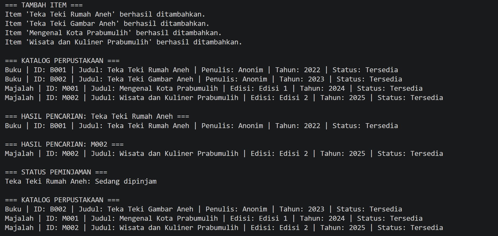

# Sistem Manajemen Perpustakaan Sederhana

## Identitas Mahasiswa
- Nama Lengkap: Frichintia Niken Gita Natasyah
- NIM: 124140106
- Kelas Praktikum: RC

## Deskripsi Program
Program ini merupakan sistem manajemen perpustakaan sederhana menggunakan Python dan konsep OOP. Program dapat menambahkan buku dan majalah, menampilkan katalog item yang tersedia, mencari item berdasarkan judul atau ID, serta melihat status peminjaman.

Penerapan konsep OOP:
1. **Class**: Terdapat class `LibraryItem`, `Book`, `Magazine`, dan `Library`.
2. **Inheritance**: Class `Book` dan `Magazine` merupakan turunan dari `LibraryItem`.
3. **Encapsulation**: Atribut `__dipinjam` dan `__koleksi` dibuat private. Atribut dengan awalan `_` digunakan sebagai protected.
4. **Polymorphism**: Method `get_detail()` memiliki implementasi berbeda pada class `Book` dan `Magazine`, tetapi dipanggil dengan cara yang sama dari class `Library`.
5. **Abstract Class**: `LibraryItem` merupakan abstract class dan memiliki abstract method `get_detail()` yang wajib diimplementasikan oleh subclass.
6. **Property Decorator**: Property `is_dipinjam` digunakan untuk membaca status peminjaman item.

## Struktur File
- `library_item.py`: Berisi abstract class `LibraryItem` dan subclass `Book` serta `Magazine`.
- `library.py`: Berisi class `Library` untuk mengelola koleksi.
- `main.py`: Program utama untuk menjalankan dan menguji fitur.

## Cara Menjalankan Program
Buka terminal pada folder kode program, kemudian jalankan perintah dibawah ini

```bash
python main.py
```

## Data Item
- Buku 1: Teka Teki Rumah Aneh
- Buku 2: Teka Teki Gambar Aneh
- Majalah 1: Mengenal Kota Prabumulih
- Majalah 2: Wisata dan Kuliner Prabumulih

## Screenshot Output


