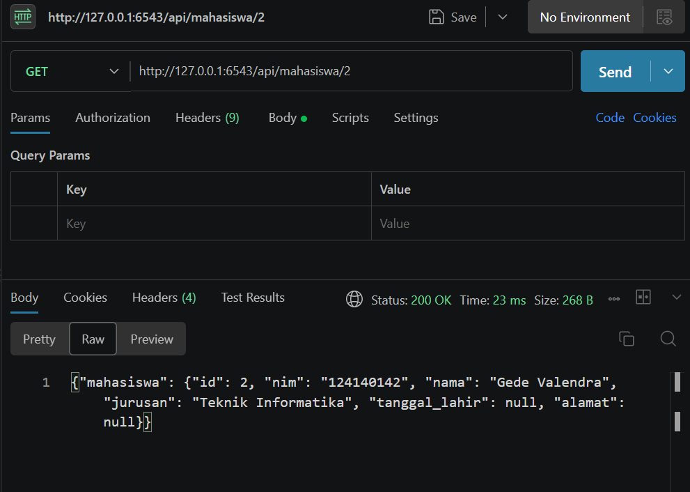
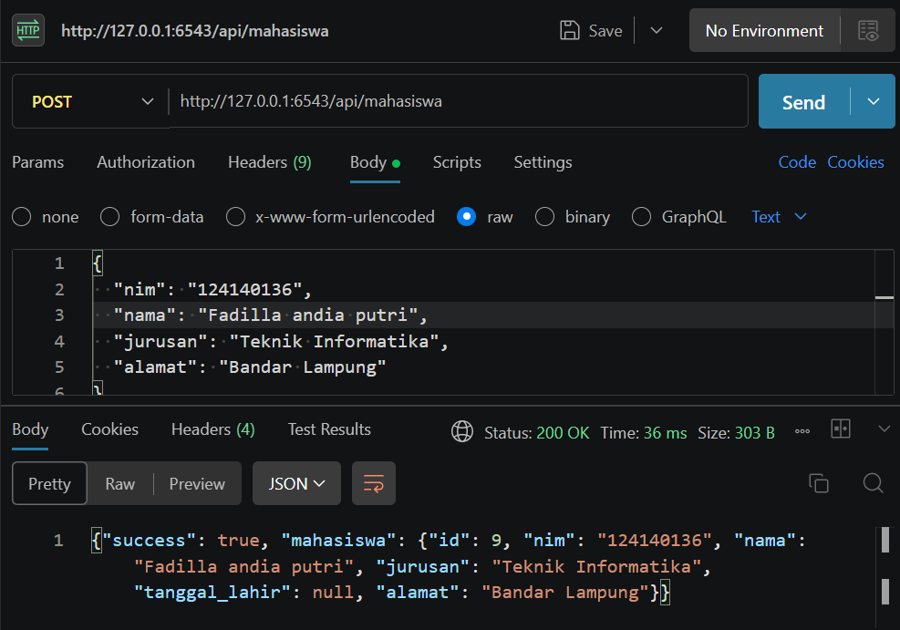
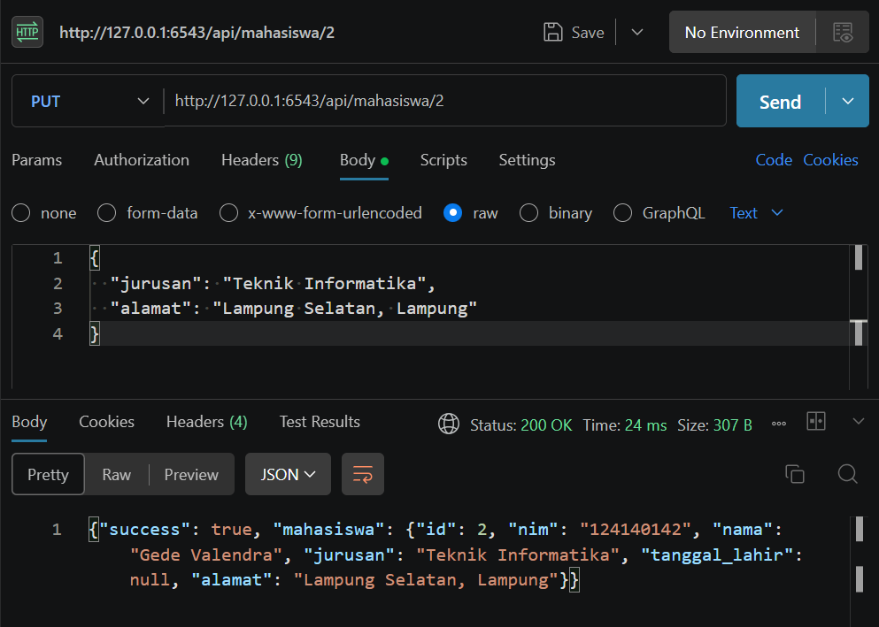
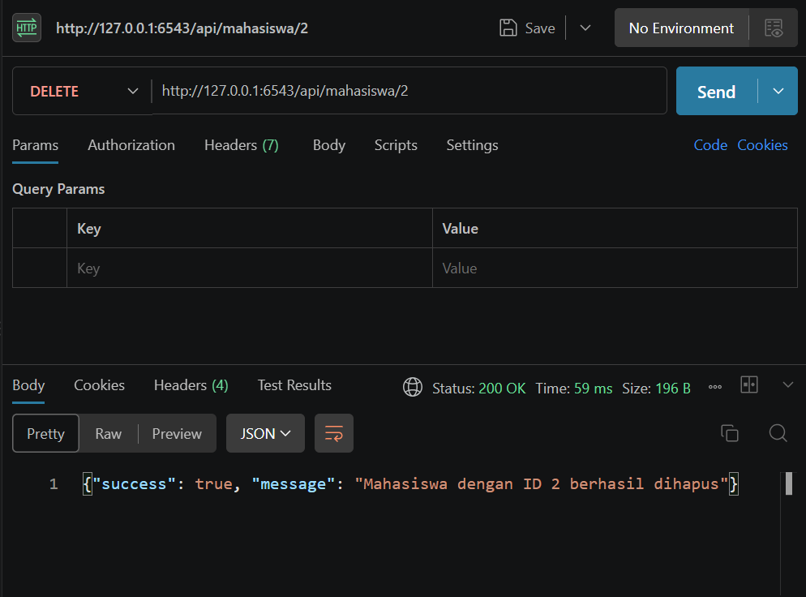
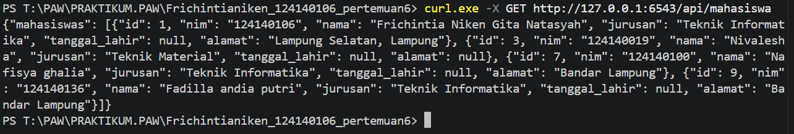
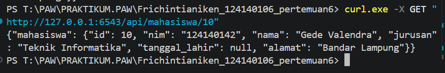
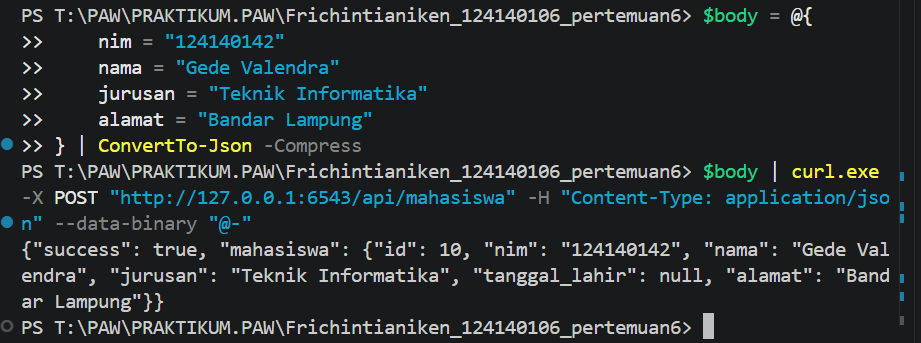
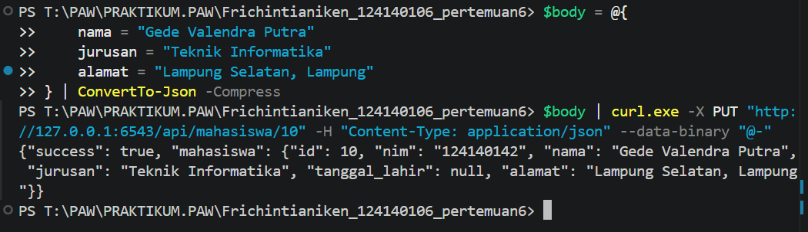
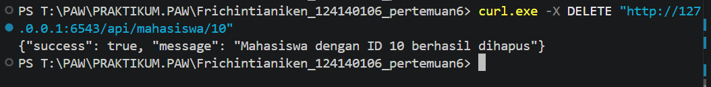

# Pertemuan 6 — Pyramid Framework

- **Nama lengkap** Frichintia Niken Gita Natasyah
- **NIM** 124140106
- **Kelas praktikum** RB

Latihan mengimplementasikan REST API data mahasiswa. Tugas memperluas aplikasi yang sama dengan REST API data matakuliah. Pyramid menerima permintaan, SQLAlchemy menyimpan data ke PostgreSQL, dan Alembic mengelola skema kedua tabel.

## Instalasi dan eksekusi di Windows

Jalankan perintah dari folder pertemuan. Siapkan Python 3.11 dan PostgreSQL.

```powershell
python --version
psql --version
python -m venv venv
.\venv\Scripts\Activate.ps1
python -m pip install -e ".[testing]"
```

Untuk database praktikum baru, jalankan `psql -U postgres`, lalu buat pengguna dan database berikut.

```sql
CREATE ROLE pyramid_user LOGIN PASSWORD 'pyramid_pass';
CREATE DATABASE pyramid_mahasiswa OWNER pyramid_user;
\q
```

Jika database sudah tersedia dengan kredensial berbeda, atur `$env:PAW6_DATABASE_URL` dengan URI koneksi PostgreSQL lokal sebelum menjalankan migrasi, seed, dan server.

```powershell
psql -h localhost -U pyramid_user -d pyramid_mahasiswa -c "SELECT current_database();"
alembic -c development.ini upgrade head
alembic -c development.ini current
initialize_pyramid_mahasiswa_db development.ini
pserve development.ini --reload
```

Revisi pertama membuat tabel `mahasiswa` dan revisi kedua menambahkan `matakuliah`. Seed mengisi tiga mahasiswa dan tiga matakuliah. Seed dapat dijalankan kembali tanpa menggandakan data dengan NIM atau kode matakuliah yang sama.

## Pengujian CRUD

Jalankan `powershell -File .\uji-api.ps1` dari terminal kedua setelah server aktif. Skrip memanggil `curl.exe` untuk setiap endpoint dan memeriksa status HTTP. Data uji memakai kode unik dan ID dari respons POST.

| Operasi | Mahasiswa | Matakuliah |
| --- | --- | --- |
| GET daftar | `/api/mahasiswa` | `/api/matakuliah` |
| GET detail | `/api/mahasiswa/{id}` | `/api/matakuliah/{id}` |
| POST tambah | `/api/mahasiswa` | `/api/matakuliah` |
| PUT ubah | `/api/mahasiswa/{id}` | `/api/matakuliah/{id}` |
| DELETE hapus | `/api/mahasiswa/{id}` | `/api/matakuliah/{id}` |

Operasi sukses mengembalikan HTTP 200. Input tidak valid, field wajib yang kosong, serta NIM atau kode matakuliah duplikat mengembalikan HTTP 400. ID yang tidak ditemukan mengembalikan HTTP 404. `sks` dan `semester` harus bilangan bulat positif.


## Bukti Pengujian Mahasiswa

Pengujian endpoint mahasiswa dilakukan menggunakan Postman dan cURL. Seluruh tangkapan layar disimpan dalam folder `screenshot`.

### Pengujian dengan Postman

#### GET Daftar Mahasiswa



#### POST Mahasiswa



#### PUT Mahasiswa



#### DELETE Mahasiswa



### Pengujian dengan cURL

#### GET Daftar Mahasiswa



#### GET Detail Mahasiswa



#### POST Mahasiswa



#### PUT Mahasiswa



#### DELETE Mahasiswa


